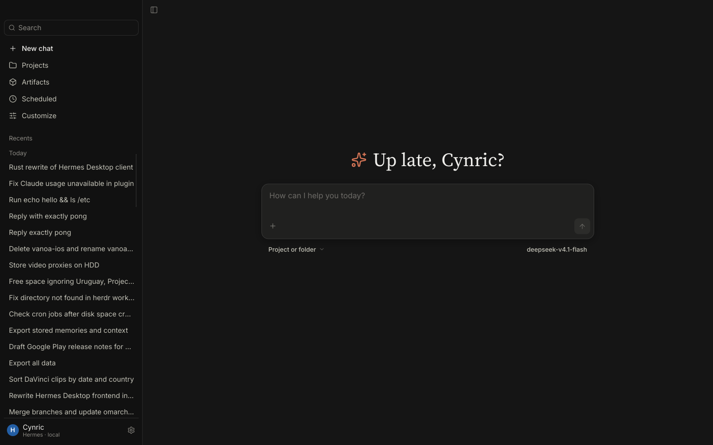
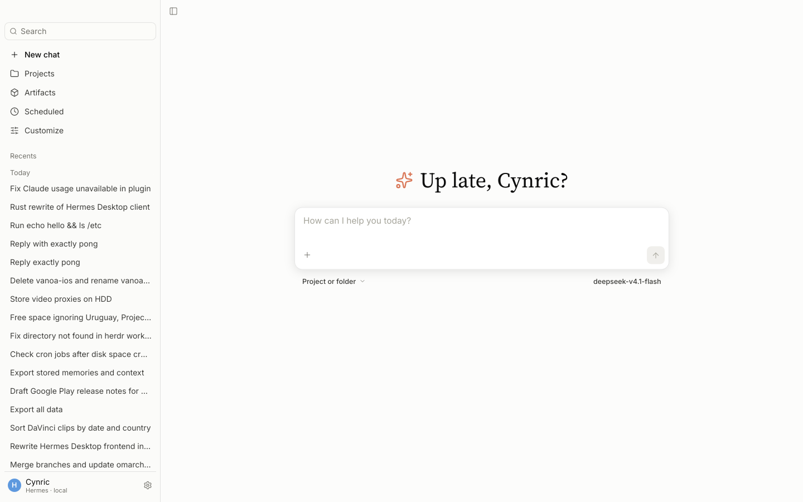
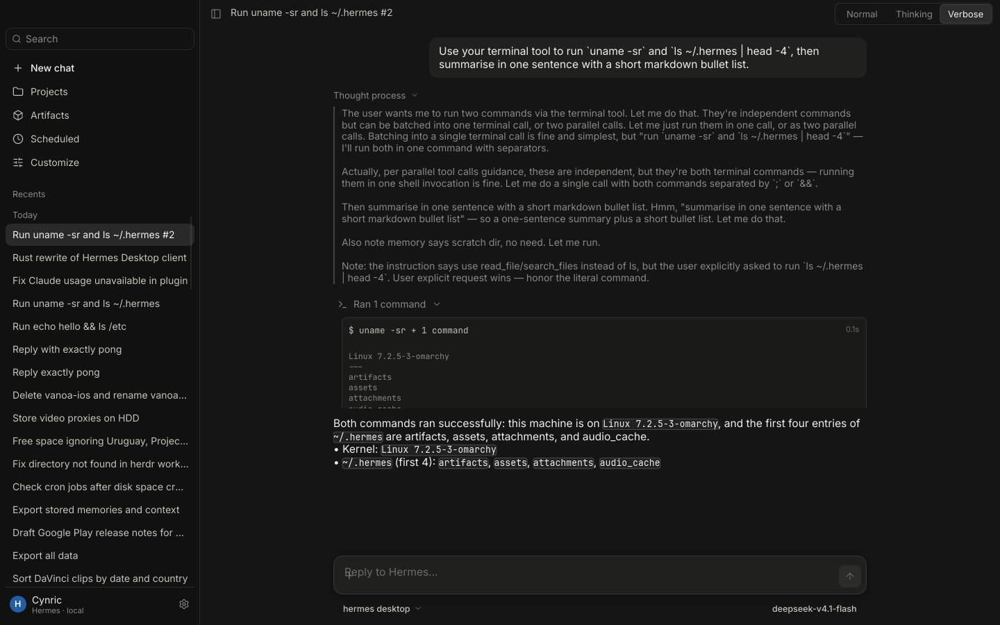
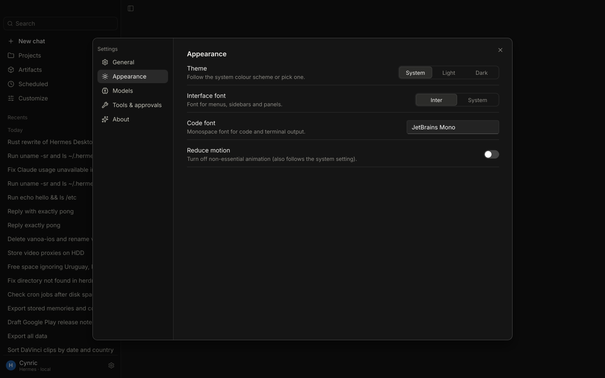

# Hermes Desktop (Rust)

A native desktop client for [Hermes Agent](https://hermes-agent.nousresearch.com), written
100% in Rust with [Slint](https://slint.dev). No web view, no Electron, no JS.

It speaks the **existing** Hermes gateway protocol (JSON-RPC 2.0 over WebSocket, the same
contract the Electron desktop and the TUI use), so the backend is unchanged. The goal is
feature parity with the current Hermes Desktop with a restrained, Claude-Desktop-inspired
look and motion.

> **Status: early.** A working vertical slice: chat with streaming against the real
> backend, sessions sidebar, thinking blocks, tool/terminal rows, approvals, model picker,
> settings shell. Progress is tracked item by item in [docs/PARITY.md](docs/PARITY.md).

| Dark — empty | Light — empty |
|---|---|
|  |  |
| **Chat (Verbose view, live backend)** | **Settings → Appearance** |
|  |  |

## Build & run

Requirements: Rust ≥ 1.88, `fontconfig`, `libxkbcommon`, `wayland`, GL/EGL; the `hermes`
CLI on `PATH` (the app attaches to the host backend, or starts `hermes serve`).

```sh
cargo run -p hermes-app --release          # binary: target/release/hermes-desktop-rs
```

Arch / Omarchy package: `cd packaging && makepkg -si` (installs the binary, a `.desktop`
entry and the icon).

### Environment

| Variable | Effect |
|---|---|
| `HERMES_DESKTOP_PORT` / `HERMES_DESKTOP_TOKEN` | attach to a specific backend |
| `HERMES_DESKTOP_ISOLATED_BACKEND=1` | always spawn a private `hermes serve` |
| `HERMES_DESKTOP_THEME=light` | system theme hint (until portal detection lands) |
| `HERMES_DESKTOP_REDUCE_MOTION=1` | disable animation |
| `RUST_LOG=startup=info` | startup phase marks (see docs/PERF.md) |
| `HERMES_DESKTOP_AUTOSEND`, `HERMES_DESKTOP_OPEN_SETTINGS=<page>`, `HERMES_DESKTOP_TRANSCRIPT_MODE=<0-2>` | dev hooks used for scripted screenshots |

## Development

```sh
cargo fmt --all
cargo clippy --workspace --all-targets -- -D warnings
cargo test --workspace
cargo run -p hermes-core --example probe   # live round trip; makes one tiny model call
```

Screenshots are taken in an isolated headless compositor so a running desktop session is
never disturbed:

```sh
weston --backend=headless --renderer=pixman --shell=kiosk --width=1440 --height=900 --socket=hermes-shot &
WAYLAND_DISPLAY=hermes-shot target/release/hermes-desktop-rs &
WAYLAND_DISPLAY=hermes-shot weston-screenshooter
```

Docs: [ANALYSIS](docs/ANALYSIS.md) (how the current desktop talks to the backend) ·
[ARCHITECTURE](docs/ARCHITECTURE.md) (crates, threading, why Slint) ·
[DESIGN](docs/DESIGN.md) (tokens and motion) · [PARITY](docs/PARITY.md) (feature checklist).

## Benchmarks

Measured 2026-10-16 on the dev machine (Omarchy, kernel 7.2, NVIDIA 610.57), release profile
(`lto = "fat"`, `codegen-units = 1`, `opt-level = 3`, `strip`, `panic = "abort"`), attached
to an already-running host backend. Full method and raw numbers: [docs/PERF.md](docs/PERF.md).

Default renderer is Slint's **software renderer** (`HERMES_DESKTOP_RENDERER=gl` for
femtovg/OpenGL). "Hidden display" = private headless Weston (no GPU); "your session" = the
owner's Hyprland/NVIDIA session, run by the owner.

| Metric | Result | Where / how |
|---|---|---|
| Binary size | 22.3 MB (stripped) | `stat` |
| First frame, software (default) | **median 49 ms** (10 runs, 47–54) | hidden display, `scripts/first-commit.py` |
| First frame, femtovg on your session | median 122 ms (5 runs, 121–163) | your session, `measure-startup.sh` |
| First frame, femtovg on hidden display | median 352 ms (llvmpipe) | hidden display |
| Idle CPU (20 s, window open) | **0 ticks** | hidden display, `/proc/<pid>/stat` |
| CPU while a reply streams | **5.8 %** of one core (7.0 % at 2× scale) | hidden display, `measure-stream-cpu.sh` |
| Memory idle, software | **PSS 24 MiB** · RSS 35 MiB | hidden display, `smaps_rollup` |
| Memory idle, femtovg on your session | PSS 79 MiB · RSS 111 MiB | your session |

**Known gaps:** the software renderer hasn't been measured on your session yet, and nothing
has been measured for long-transcript scrolling yet. The Electron Hermes Desktop wasn't
running, so there is no side-by-side comparison yet.

## Licences

Code: MIT. Bundled fonts (Inter, Source Serif 4, JetBrains Mono): SIL OFL 1.1, texts in
`assets/fonts/`. Icons: Lucide (ISC), `assets/icons/LICENSE-lucide.txt`. The app icon
(`packaging/hermes-desktop-rs.svg`) is original. No Anthropic assets are used; the look is
recreated from observation with openly licensed fonts and icons.
